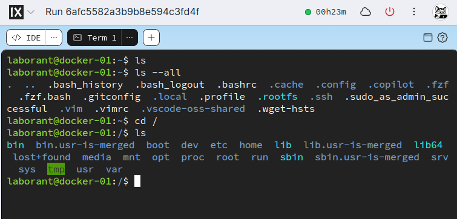
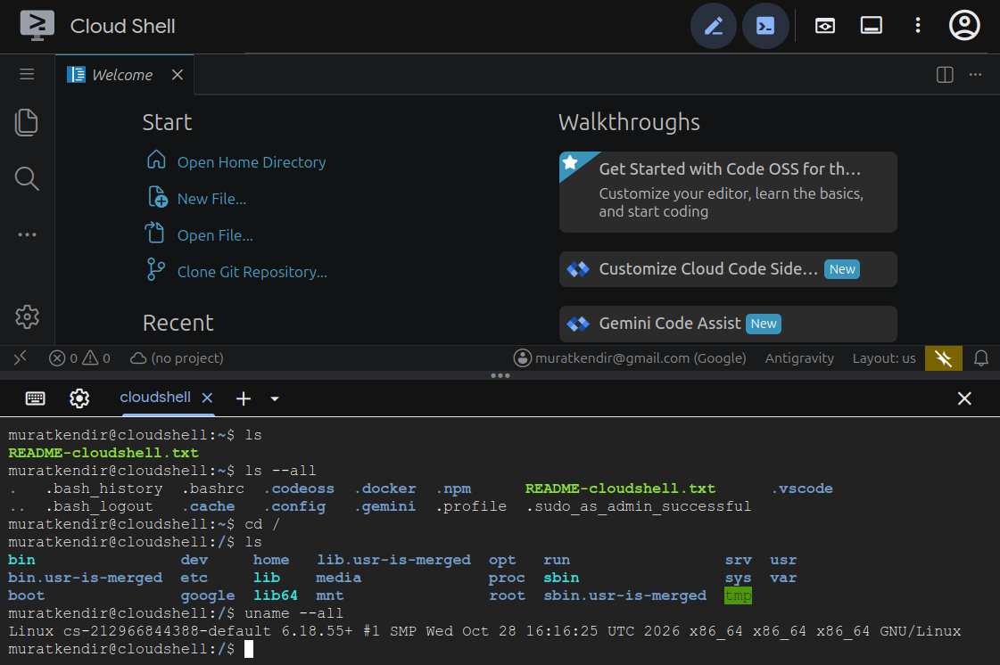
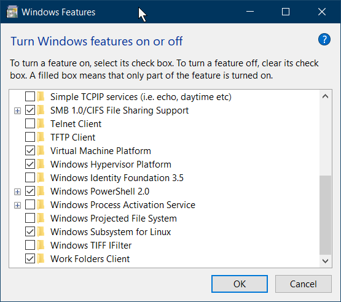
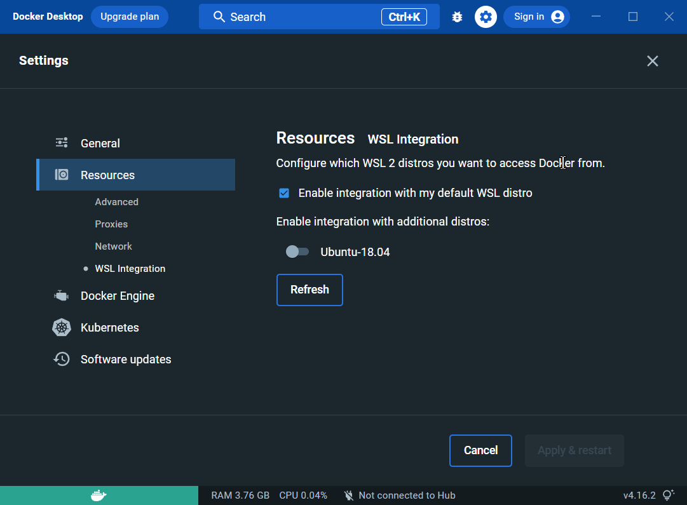
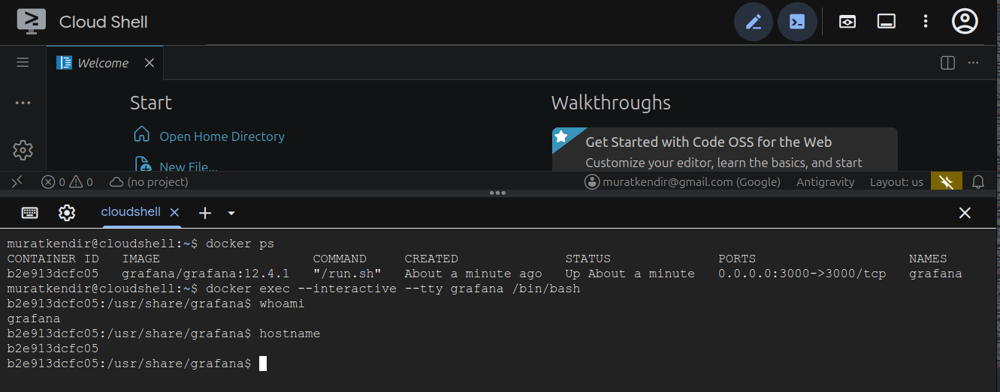
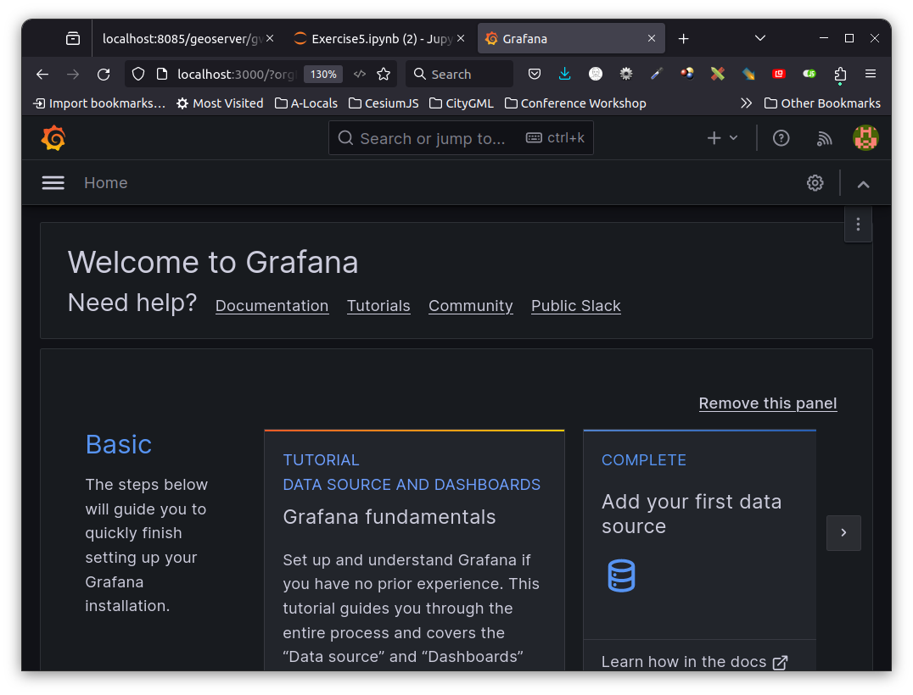
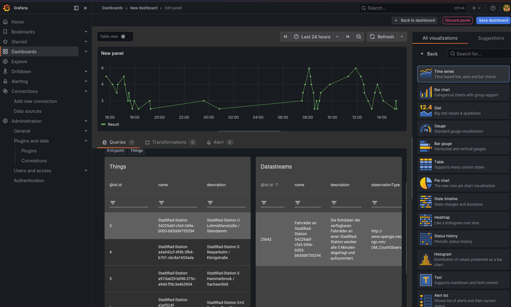

# Exercise - Docker Usage


<blockquote>
Munich Technical University / Chair of Geoinformatics <br>
Murat Kendir, Rupal Srivastava, Prof. Thomas Kolbe <br>
murat.kendir@tum.de 
</blockquote>

<div align="right" style="font-size:0.5em;">v. WiSe 2026-2027</div>

## Table of Contents

- [0. Aim of the Exercise](#0-aim-of-the-exercise)
    - [0.1. General Preparation](#01-general-preparation)
    - [0.2. Cheatsheets](#02-cheatsheets)
- [1. Practice with Docker](#1-practice-with-docker)
    - [1.1. Play With Docker Container (via Iximiuz)](#11-play-with-docker-container-via-iximiuz)
    - [1.2. Alternative Playground : Google Cloud Shell](#12-alternative-playground-google-cloud-shell)
    - [1.3. Why do we use Docker?](#13-why-do-we-use-docker)
- [2. First Practice on the Local Machine with Docker](#2-first-practice-on-the-local-machine-with-docker)
    - [2.1. Docker Desktop Installation on Windows systems - Optional](#21-docker-desktop-installation-on-windows-systems-optional)
    - [2.2. Running Docker Container as an Instance](#22-running-docker-container-as-an-instance)
    - [2.3. What actually happens after executing the "docker run" command?](#23-what-actually-happens-after-executing-the-docker-run-command)
    - [2.4. How to remove/delete docker images from the instance? - Optional](#24-how-to-removedelete-docker-images-from-the-instance-optional)
    - [2.5. Docker Cheatsheet and the Relevance between linux commands](#25-docker-cheatsheet-and-the-relevance-between-linux-commands)
    - [2.6. Access to the Grafana Dashboard](#26-access-to-the-grafana-dashboard)
    - [2.7. Add some data into Grafana](#27-add-some-data-into-grafana)


## 0. Aim of the Exercise

This exercise primarily focuses on the usage of docker virtualization. You will practice with docker command line interface or the desktop application by running and inspecting some containers and images. In general, you will need to complete the following tasks:

- Learn how to use Docker using the given preparation materials (see step 0.1.)
- Run a **docker container** running the PlantUML Server and Grafana (Analytics & Visualization App) on your own machine.
- Try to reach out to the server.

You can refer to the following resources when needed:

### 0.1. General Preparation

- [ ] Check the <a href="https://www.youtube.com/watch?v=rOTqprHv1YE" target="_blank">What is Docker and How it works?</a> video (16 min)
- [ ] Check the page <a href="https://docs.docker.com/get-started/introduction/" target="_blank">"Docker - Get started - Introduction"</a> and follow the instructions below one of the options (Docker Desktop / Play with Docker) (~15 min).

### 0.2. Cheatsheets

- [ ] <a href="https://docs.docker.com/get-started/docker_cheatsheet.pdf" target="_blank">Docker CLI (Command Line Interface) Cheat Sheet</a>

## 1. Practice with Docker

### 1.1. Play With Docker Container (via Iximiuz)

Open the following website:
[Docker Playground](https://labs.iximiuz.com/playgrounds/docker)

> Please note: the Playground on Iximiuz will only run for 1 hour. The configurations and containers may be deleted after this period.

- [ ] Click to `Start Playground` and select one of the possible login options for you.
- [ ] Docker Playground will be launched and a session will be started which will be kept until the session ends (~1 hour).
    - For more information about the lifetime of the Virtual Machines (VMs) invoked in Iximiuz Docker Playground, visit this [page](https://labs.iximiuz.com/docs/playgrounds/persistent-playgrounds#preserving-progress).
- [ ] Find the "Playground Runs" widget on the right side of the current page, and click to the "Run ..." command.  
- [ ] A unix-based virtual machine (VM) will be started with a specific computer name, user name and (internal) ip address within a predefined Operating System.
    - [ ] Check the computer name : `hostname`
    - [ ] Check the current user name : `whoami` or `echo $USER`
    - [ ] Check the current ip address : `ip address show`
    - [ ] Check the operating system that the VM runs : `uname --all`
    - [ ] Check the type of system in which you are going to play with docker : `systemd-detect-virt`
        - If the output is “none”, it means you are running the command on a physical machine. If the output is "kvm" or "wsl" (Windows Subsystem for Linux), it means you are running the command on a virtual machine (VM). If the output is "docker", "podman", or "lxc", it means you are running the command inside a container.
- [ ] You can also control the temporary VM instance from your terminal using SSH. To do that, go back to the main page and find the three dots icon placed next the container name, then choose `Connect from Terminal`.
- [ ] Run the following code to estblish a PlantUML-Server app on a docker container :
    - [ ] `docker run --detach --publish 8080:8080 --name puml-server plantuml/plantuml-server:jetty` 
- [ ] Check whether the docker container is running by typing `docker ps`.
    - Notice that, the specified name (via `--name` option) appeared on the latest column. You can use both the name or container ID to refer it in your next commands. 
- [ ] If it is running, then find the web interface icon on top right side corner of the web page and specify the port (8080) on the upcoming window.
- [ ] Click to `Expose` button and visit the URL appeared on the bottom side of the window.
    - Hereby, you will able to reach to the web interface of your PlantUML-Server web application, which can be used for visualizing PlantUML based diagrams.
- [ ] Access to the docker container by using `exec` as the command given below:
    - `docker exec --interactive --tty puml-server /bin/bash`
    - If you accessed into the  docker container, try to send similar commands given above:
        - [ ] `hostname`
        - [ ] `whoami`
        - [ ] `hostname -i` (Since the container is based on a minimal unix-based system, it may not support the `ip` or `ifconfig` commands)
        - [ ] `uname --all`

<figure style="width:%100;text-align: center;">
  
  <figcaption>Iximiuz Docker Playground</figcaption>
</figure>


### 1.2. Alternative Playground : Google Cloud Shell

An alternative playground would be : [Google - Cloud Shell](https://shell.cloud.google.com)
This web site provides a browser-based Command Line Interface (CLI) with a preinstalled docker application. So, you will be able to manage docker containers, images, networks without any installation on your computer.

- [ ] List the running docker containers by typing ```docker ps``` in the terminal screen (e.g. command prompt of the instance).
- [ ] If you want to check all (running and idle) available docker containers, type ```docker ps --all```
- [ ] Check all available commands: ```docker --help```
- [ ] If you want to check command-specific options and arguments, type ```docker any_command -- help``` (For exp. ```docker ps --help```)
- If you want to continue to practice on Google Cloud Shell, skip to the step 2.2. and try to establish a Grafana Dashboard instance by using the same docker commands.

> TIP: The terminal screen and available commands here will have the same or similar commands as a Linux terminal screen (command line), because usually the virtual machines run on a linux system. To check which version of Linux is used as the base operating system, type `uname --all` in the terminal.

<figure style="width:%100;text-align: center;">
  
  <figcaption>Google Cloud Shell</figcaption>
</figure>

### 1.3. Why do we use Docker?

To explain why we use virtualization tools such as Docker, we need to summarize the difficulties encountered in any programming process:

- A program script prepared in any programming language may depend on multiple libraries. It is important to know which version of which library is compatible with the main program. Incorrect versions of libraries can prevent the main program from running.
- Codes prepared in programming languages do not run directly in machine code. They must be compiled to run in machine code. It is important to know on which hardware and operating system this compilation process is performed. Software compiled in one system configuration may not work in another configuration.
- Running a program designed for server architecture can consume a lot of unnecessary resources. For example, the CPU processing power you allocate to run a single program when requested by clients remains idle when there are no requests for the same program.

In this case, taking advantage of virtualization tools such as Docker provides us with the following opportunities in programming and system architecture tasks:

- System requirements are met directly on pre-configured virtual machines. The main program can be run directly along with dependent libraries.
- Since the main program is compiled for virtual machines, these compiled and optimized configurations can be run directly on any other system.
- Since virtualization tools (with Hypervisor support) operate on the principle of sharing system resources, software requirements can be distributed as needed. This results in a more efficient and environmentally friendly architecture. 

## 2. First Practice on the Local Machine with Docker

### 2.1. Docker Desktop Installation on Windows systems - Optional

<figure style="width:%100;text-align: center;">
  
  <figcaption>Windows (Built-in) Features</figcaption>
</figure> 

Follow the next steps if you want to download and install the Docker Desktop or CLI tool on your personal computer, otherwise skip to the step 2.2.

- If this is your first time downloading and installing Docker Desktop, it may be more effective to enable the **WSL2** option in Docker Settings.
- Search for "**Windows Properties**" and try to enable "**Windows Subsystem**". It is mandatory to enable **Hyper-V**. Hyper-V is a virtualization support that might be provided by your computer's CPU hardware. If it is not possible to enable it, you should check the BIOS configuration and look for a virtualization support option (it is usually on the "Advanced" page or tab).
- Enable Windows Subsystem 
- Click on the gear icon in the top right corner and go to **Resources \ WSL Integration**.
- At the first start of the Docker Desktop app, log in to Docker Hub using the Login button in the top right corner.
- You will continue using the CLI (Command Line Interface) tool, but you can still check the Desktop App to view the containers, images etc.

<figure style="width:%100;text-align: center;">
  
  <figcaption>WSL2 Option</figcaption>
</figure>


### 2.2. Running Docker Container as an Instance

- [ ] There is no working docker containers yet.
- [ ] Start a new docker container by typing:
    ```bash
    docker run -d -p 3000:3000 \
    --name=grafana \
    -e "GF_INSTALL_PLUGINS=iosb-sensorthings-datasource" \
    grafana/grafana:12.4.1
    ```
  - Explanations of options and arguments:
    -  **\-d or \-\-detach** : The container continues to run in the background.
    - **\-p or \-\-publish** : Forward (Publish) a port in the container to the host (Left side shows the port of the host machine and right side of the column shows the port of the container)
    - **\-e or \-\-env** : Sets environment variables
    - **\-\-name (no alias)** : Assign a name to the container, to easily recognize containers.
    - **grafana/grafana:12.4.1** means "publisher/image:anyTag" : The last argument is the full name of the docker image. Usually, tags include version numbers.
- [ ] Check the available docker containers by typing ```docker ps```

### 2.3. What actually happens after executing the "docker run" command?

- The Docker app checked if the requested image (grafana/grafana:latest) already exists in our host machine. 
- If it is not available, it tries to download it from **Docker Hub** by searching for the same image name.

- [ ] Visit the Docker Hub page and search for our image manually:
  - [hub.docker.com](https://hub.docker.com)
  - In the meantime, docker hub is not the only docker image repository, but the docker application assumes that if the repository is not explicitly specified, the default hub (docker.io) will be used for searching the image. You can use another docker image repository (such as ghcr.io, mcr.microsoft.com, registry.gitlab.com etc.) by adding the URL of the repository to the beginning of the image name (for exp. `docker run ghcr.io:grafana/grafana:12.4.1`)
- You can optionally search for any docker image on the command line:
  - ```docker search grafana```
- Check the available docker images in the host machine:
  - ```docker image ls```
- If you need to access into the Docker container, you can use `docker exec` as follows:
  - `docker exec --interactive --tty CONTAINER_NAME /bin/bash`

<figure style="width:%100;text-align: center;">
  
  <figcaption>Invoking Docker Containers in Google Cloud Shell</figcaption>
</figure>


### 2.4. How to remove/delete docker images from the instance? - Optional

If you see multiple Docker containers running and a number of irrelevant Docker images on your system, you can remove them by following the instructions below. If not, you can move on to the next topic.

- [ ] Try deleting the image:
  - ```docker rmi grafana/grafana:latest```
- [ ] When an image is referenced to a container, the terminal will show an error and the container may still be running. So what we need to do is first stop the running container and then remove the referenced container:
  - ```docker stop CONTAINER_NAME```
  - or alternatively use the container ID shown in
    - Type ```docker container list``` (same as "ps" command) to see container IDs and names.
    - ```docker stop CONTAINER_ID```
- [ ] Check existing containers with the -all option:
  - ```docker ps --all```
- [ ] Remove the container:
- ```docker rm grafana```
  - or alternatively with Container ID:
    - ```docker rm 829224beac3f``` (container IDs are not predefined/fixed numbers, try to find the container IDs running on your system and replace them with the given one.)
- [ ] Finally, remove the image from your instance:
  - ```docker rmi grafana/grafana:latest```

### 2.5. Docker Cheatsheet and the Relevance between linux commands

Many command abbreviations are inherited from Linux/Unix-based systems. These long command names can be used, for example, to make it easier to memorize abbreviated commands:

- cp : Copy
- rm : Remove
    - rmi : Remove Image (used only in the virtualization tools) 
- exec : Execute
- cd : Change Directory
- ls : List
- ps : Processes
- diff : Difference

> TIP: However, one of the best ways to learn these commands is not to memorize them but to use a "Cheatsheet" document as an aid during the exercises. If you want to use such a document, visit this page: [Docker CLI Cheat Sheet](https://docs.docker.com/get-started/docker_cheatsheet.pdf)


### 2.6. Access to the Grafana Dashboard

- [ ] If you have already removed the container and image while following the instructions in section 1.4, start from scratch and start the docker container with the same command given earlier:
  - ```docker run -d -p 3000:3000 --name=grafana -e "GF_INSTALL_PLUGINS=iosb-sensorthings-datasource" grafana/grafana:12.4.1```
- [ ] Now click the **Open Port** button at the top of the page and specify port **3000**. If your forwarded/published port is different, check the actual port number by typing ```docker ps```.
- [ ] Type "admin" as username and password.
- [ ] Grafana will ask for a new password on the next page, type any password.
- If everything is OK, the Grafana start page will be shown.

<figure style="width:%100;text-align: center;">
  
  <figcaption>Grafana Interface</figcaption>
</figure>

### 2.7. Add some data into Grafana

- Go to the *Datasources* in the side menu on left.
- Click to the `Add Datasource` button, then search for "Frost". "Frost Sensorthing API Plugin" must appear. Select it.
- Set the **HTTP URL** as  `https://iot.hamburg.de/v1.1`, and then click to `Save&Test` button on the bottom side of the page.
- If everything is ok, a success message would appear. There you can find a link `building dashboard`. If not, go to the `Dashboards` on the left menu and click to `Create a Dashboard` button.
- Click to "Add Visualization" button and select the *Frost SensorThings Plugin* in the next step.
- Next page is dedicated to interactively setting the dashboard by considering the available data source on the selected plugin. Find the `Select Entrypoint` option on the bottom pane, and choose a random **Thing** from the IOT Server and select one of the available **datastreams** which will appear on the right side of the bottom pane.
- If the datastream does not contain enough records for the selected time interval, change it from the top right side of the graphic panel.

<figure style="width:%100;text-align: center;">
  
  <figcaption>Sample Dashboard on Grafana</figcaption>
</figure>
